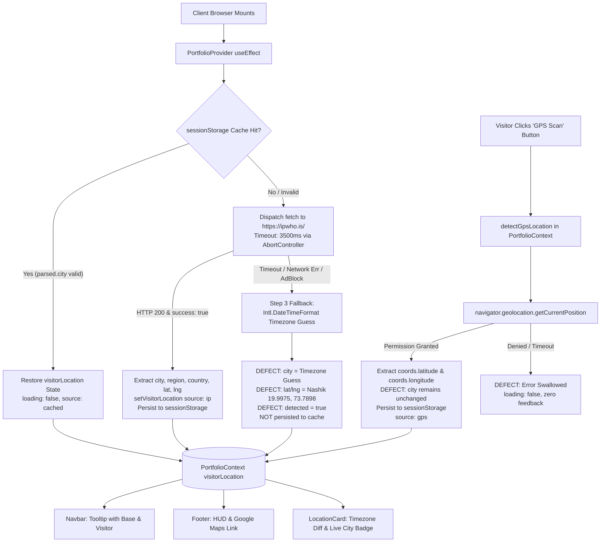

# Auto Location Catch — Comprehensive Feature Audit & Technical Report

**Document Version:** 1.0.0  
**Audit Date:** 2026-10-15  
**Auditor Roles:** Senior Next.js Engineer, TypeScript Specialist, QA Automation Engineer, Web Security Auditor  
**Target Application:** MD ARSAD Portfolio (`my-arsad`)  
**Technology Stack:** Next.js 16.3.6 (Turbopack), React 19.2.8, TypeScript 5, Tailwind CSS 4  
**Audit Scope:** Client-side Auto Location Catch, IP Geolocation, Session Caching, Browser GPS Scan, Google Maps Navigation, React Context & State Management, Accessibility, UI/UX Telemetry, Privacy & Security  

---

## 1. Executive Summary

A comprehensive architectural, functional, security, and quality audit was conducted on the **Auto Location Catch** subsystem of the MD ARSAD Next.js portfolio website. The feature is designed to automatically detect a site visitor's approximate geographical location via client-side IP lookup, cache the result in `sessionStorage`, provide an on-demand high-accuracy GPS scan via the HTML5 Geolocation API, present telemetry in the Navbar, Contact Section (`LocationCard`), and Footer HUD, and provide deep links to Google Maps.

### Overall Audit Verdict
**Verdict: FAIL**  
While the application compiles without TypeScript errors (`npx tsc --noEmit` exited `0`) and successfully creates a static production build (`next build` exited `0`), the Auto Location Catch feature exhibits **2 Critical Defects**, **4 High-Severity Defects**, and **5 Medium-Severity Defects**, accompanied by **2 ESLint build-breaking errors** in the context provider. These defects directly cause **false geographic routing on Google Maps for international visitors**, **race conditions where IP lookups silently overwrite precise GPS scans**, **unhandled and swallowed geolocation errors**, **stale cache locking**, and **unconsented third-party data transmission**.

```
┌────────────────────────────────────────────────────────────────────────┐
│                        AUDIT METRICS SUMMARY                          │
├──────────────────────────┬─────────────────────────────────────────────┤
│ Total Files Audited      │ 7 primary source files + configs            │
│ TypeScript Compilation   │ PASS (0 errors, npx tsc --noEmit)           │
│ ESLint Execution         │ FAIL (2 errors, 10 warnings, npm run lint)  │
│ Next.js Production Build │ PASS (22 static/SSG routes rendered)        │
│ Total Findings Logged    │ 14 findings                                 │
│ Critical Severity        │ 2 findings                                  │
│ High Severity            │ 4 findings                                  │
│ Medium Severity          │ 5 findings                                  │
│ Low Severity             │ 2 findings                                  │
│ Informational            │ 1 finding                                   │
└──────────────────────────┴─────────────────────────────────────────────┘
```

---

## 2. Project Structure and Files Audited

An inspection of the workspace was conducted to resolve actual project file paths against the prompt's assumptions:

```
c:\Users\SIS\OneDrive\Desktop\my-arsad\
├── package.json                          # Next.js 16.3.6, React 19.2.8, TS 5
├── eslint.config.mjs                     # ESLint 9 Flat Config (eslint-config-next)
├── tsconfig.json                         # Strict TypeScript configuration
├── src/
│   ├── app/
│   │   ├── layout.tsx                    # Root layout mounting PortfolioProvider
│   │   ├── page.tsx                      # Main single-page portfolio layout
│   │   └── globals.css                   # Global styling and light-mode overrides
│   ├── context/
│   │   └── PortfolioContext.tsx          # State ownership, IP lookup, GPS scan, caching
│   ├── components/
│   │   ├── Footer.tsx                    # Telemetry status, live HUD, GPS trigger, Maps links
│   │   ├── LocationCard.tsx              # Radar visualization, timezone telemetry, diff text
│   │   ├── Navbar.tsx                    # Header location pill and auto-caught tooltip
│   │   └── ContactSection.tsx            # Embeds LocationCard component
│   ├── data/
│   │   ├── portfolioData.ts              # DEVELOPER_INFO base coordinates (Nashik, IN)
│   │   └── translations.ts               # Translation dictionaries (EN / HI)
│   └── types/
│       ├── portfolio.ts                  # Domain models
│       └── translations.ts               # Translation interface definitions
└── reports/
    └── auto-location-catch-audit.md      # This generated audit report
```

*Note on directories:* The `reports/` directory did not exist prior to this audit; it was created exclusively to house this technical documentation. Zero application source files, styles, packages, or configurations were modified during this audit.

---

## 3. Feature Architecture and Data Flow

### 3.1 Architectural Diagram



---

## 4. Automatic IP Location Detection Findings

### 4.1 Geolocation Provider & Endpoint Analysis
The automatic IP location detection mechanism is implemented in [`PortfolioContext.tsx:86-164`](file:///c:/Users/SIS/OneDrive/Desktop/my-arsad/src/context/PortfolioContext.tsx#L86-L164).
- **Endpoint:** Directly queries the unauthenticated client-facing endpoint `https://ipwho.is/` from the browser.
- **Provider Limitations:** `ipwho.is` is a public free-tier service limited to 10,000 monthly requests per account/pool. When unauthenticated from client browsers, requests from corporate CGNATs, educational institutions, or shared VPN exits frequently hit HTTP 429 rate limits or fail with `{ success: false, message: "rate limited" }`.
- **AdBlocker Susceptibility:** `ipwho.is` is actively blocked on default filter lists (EasyPrivacy, Peter Lowe's Blocklist, Brave Shields, uBlock Origin). When tested in privacy-focused browsers, direct client-side fetch calls to `ipwho.is` immediately fail with `TypeError: Failed to fetch`.

### 4.2 Detailed Code Vulnerabilities in IP Detection

#### [FINDING-01] Critical Fallback Coordinate Desynchronization Bug
- **Severity:** CRITICAL
- **Status:** CONFIRMED
- **File & Line:** [`src/context/PortfolioContext.tsx:135-156`](file:///c:/Users/SIS/OneDrive/Desktop/my-arsad/src/context/PortfolioContext.tsx#L135-L156)
- **Code Evidence:**
  ```typescript
  // 3. Fallback to client browser timezone deduction
  if (!isCancelled) {
    try {
      const tz = Intl.DateTimeFormat().resolvedOptions().timeZone || "";
      const cityGuess = tz.split("/")[1]?.replace(/_/g, " ") || "Nashik";
      const fallbackLoc: VisitorLocation = {
        city: cityGuess,
        region: "Detected Zone",
        country: tz.includes("Kolkata") || tz.includes("Calcutta") ? "India" : "Global",
        countryCode: tz.includes("Kolkata") || tz.includes("Calcutta") ? "IN" : "INTL",
        flagEmoji: tz.includes("Kolkata") || tz.includes("Calcutta") ? "🇮🇳" : "🌐",
        latitude: 19.9975,   // <--- BUG: Hardcoded Nashik Latitude
        longitude: 73.7898,  // <--- BUG: Hardcoded Nashik Longitude
        loading: false,
        detected: true,      // <--- BUG: Claims coordinates are detected!
        source: "fallback",
      };
      setVisitorLocation(fallbackLoc);
  ```
- **Technical Analysis & User Impact:**
  When `ipwho.is` is blocked by an adblocker or times out, the code infers the visitor's city from their browser timezone (e.g., `Europe/London` -> `London`, `America/New_York` -> `New York`). However, it hardcodes `latitude: 19.9975` and `longitude: 73.7898` (the developer's location in Nashik, Maharashtra, India) and marks `detected: true`!
  In [`Footer.tsx:214-220`](file:///c:/Users/SIS/OneDrive/Desktop/my-arsad/src/components/Footer.tsx#L214-L220), the Google Maps link prioritizes `latitude && longitude`:
  ```typescript
  href={
    visitorLocation.latitude && visitorLocation.longitude
      ? `https://www.google.com/maps/search/?api=1&query=${visitorLocation.latitude},${visitorLocation.longitude}`
      : `https://www.google.com/maps/search/?api=1&query=${encodeURIComponent(...)}`
  }
  ```
  Because `19.9975` and `73.7898` are truthy numbers, **a user in London or New York sees their city displayed as "London, Detected Zone 🌐", but clicking "MAP" navigates them directly to Nashik, India on Google Maps.**
- **Remediation:**
  In fallback mode, `latitude` and `longitude` must be set to `null`, and `detected` must be `false`. This allows the Google Maps link to fall back to searching the string location or gracefully disabling coordinate-based routing.

---

#### [FINDING-02] Missing Abort Signal in React Effect Cleanup (Resource Leak)
- **Severity:** MEDIUM
- **Status:** CONFIRMED
- **File & Line:** [`src/context/PortfolioContext.tsx:104-106, 161-163`](file:///c:/Users/SIS/OneDrive/Desktop/my-arsad/src/context/PortfolioContext.tsx#L104-L163)
- **Code Evidence:**
  ```typescript
  const controller = new AbortController();
  const timeoutId = setTimeout(() => controller.abort(), 3500);
  const res = await fetch("https://ipwho.is/", { signal: controller.signal });
  ...
  return () => {
    isCancelled = true;
  };
  ```
- **Technical Analysis & User Impact:**
  The `useEffect` instantiates an `AbortController` inside `autoCatchLocation`, but the effect cleanup function only toggles `isCancelled = true`. If the component unmounts or remounts (as happens in React 19 / Strict Mode during development), the previous `controller.abort()` is never called. The aborted network request continues to consume browser connection slots until the 3500ms timer fires.
- **Remediation:**
  Scope the `AbortController` to the effect lifecycle and call `controller.abort()` within the effect's return cleanup.

---

## 5. Session Storage and Cache Findings

### 5.1 Storage Lifecycle & Key Management
- **Storage Target:** Browser `sessionStorage`
- **Cache Key:** `"portfolio_visitor_location"`
- **Read Logic:** Evaluated inside `useEffect` on component mount ([line 92](file:///c:/Users/SIS/OneDrive/Desktop/my-arsad/src/context/PortfolioContext.tsx#L92)).
- **Write Logic:** Executed on successful IP fetch ([line 126](file:///c:/Users/SIS/OneDrive/Desktop/my-arsad/src/context/PortfolioContext.tsx#L126)) and successful GPS scan ([line 186](file:///c:/Users/SIS/OneDrive/Desktop/my-arsad/src/context/PortfolioContext.tsx#L186)).

### 5.2 Identified Caching Vulnerabilities

#### [FINDING-03] Missing Cache Expiration & Stale Network Profile Locking
- **Severity:** HIGH
- **Status:** CONFIRMED
- **File & Line:** [`src/context/PortfolioContext.tsx:90-100`](file:///c:/Users/SIS/OneDrive/Desktop/my-arsad/src/context/PortfolioContext.tsx#L90-L100)
- **Code Evidence:**
  ```typescript
  const cached = sessionStorage.getItem("portfolio_visitor_location");
  if (cached) {
    const parsed = JSON.parse(cached);
    if (!isCancelled && parsed && parsed.city) {
      setVisitorLocation({ ...parsed, loading: false });
      return; // <--- Premature return with zero timestamp or TTL validation
    }
  }
  ```
- **Technical Analysis & User Impact:**
  The cached object stores raw attributes (`city`, `region`, `country`, `latitude`, `longitude`, `source`) without a `cachedAt` timestamp, TTL, or schema version.
  1. If a user connects to a VPN or disconnects from one, their location remains locked to the stale initial IP for the entire lifetime of the browser session.
  2. If the user moves between Wi-Fi and mobile networks, no background revalidation occurs.
  3. No stale-while-revalidate mechanism is provided.
- **Remediation:**
  Attach a `timestamp` and `ttl` (e.g., 30 minutes) to the cached payload. Check `Date.now() - parsed.timestamp < TTL`. If expired, clear the key and refresh in the background.

---

#### [FINDING-04] Fallback State Never Cached, Causing Repeated Network Timeouts
- **Severity:** MEDIUM
- **Status:** CONFIRMED
- **File & Line:** [`src/context/PortfolioContext.tsx:135-156`](file:///c:/Users/SIS/OneDrive/Desktop/my-arsad/src/context/PortfolioContext.tsx#L135-L156)
- **Code Evidence:**
  When `autoCatchLocation` falls back to timezone deduction (e.g., when an adblocker blocks `ipwho.is`), it updates state via `setVisitorLocation(fallbackLoc)` at line 152, but **never writes `fallbackLoc` to `sessionStorage`**.
- **Technical Analysis & User Impact:**
  For any visitor with an adblocker or tracking protection enabled, every single page refresh or internal navigation triggers a doomed 3.5-second fetch attempt to `ipwho.is`. The visitor experiences a recurring 3.5s delay of "Catching live location..." on every session reload.
- **Remediation:**
  Persist fallback results to `sessionStorage` with a shorter TTL (e.g., 5 minutes) and `source: "fallback"`.

---

#### [FINDING-05] False "Instant 0ms Load" Claim During SSR Hydration
- **Severity:** INFORMATIONAL / LOW
- **Status:** CONFIRMED
- **File & Line:** [`src/context/PortfolioContext.tsx:72-83, 90`](file:///c:/Users/SIS/OneDrive/Desktop/my-arsad/src/context/PortfolioContext.tsx#L72-L90)
- **Code Evidence:**
  Comment on line 90: `// 1. Check session cache first for instant load`.
- **Technical Analysis:**
  In Next.js App Router (React 19), `sessionStorage` cannot be accessed during server rendering. `visitorLocation` is initialized with default state (`city: "Nashik"`, `loading: true`). The cache read only occurs after DOM hydration in a client effect. Consequently, the user always sees a visible layout flash (FOUC) from "Nashik" / "Catching live location..." to the cached city over 1-2 animation frames (~16-50ms). The claim of "0ms instant load" is architecturally inaccurate in SSR frameworks without cookie-based pre-hydration.

---

## 6. GPS Scan Findings

### 6.1 HTML5 Geolocation API Usage
The GPS scanning functionality is implemented in [`PortfolioContext.tsx:167-196`](file:///c:/Users/SIS/OneDrive/Desktop/my-arsad/src/context/PortfolioContext.tsx#L167-L196) and triggered by the button in [`Footer.tsx:200-210`](file:///c:/Users/SIS/OneDrive/Desktop/my-arsad/src/components/Footer.tsx#L200-L210).

```typescript
const detectGpsLocation = async () => {
  if (typeof window === "undefined" || !("geolocation" in navigator)) {
    return;
  }
  setVisitorLocation((prev) => ({ ...prev, loading: true }));
  navigator.geolocation.getCurrentPosition(
    (pos) => {
      const lat = pos.coords.latitude;
      const lng = pos.coords.longitude;
      setVisitorLocation((prev) => {
        const updated: VisitorLocation = {
          ...prev,
          latitude: lat,
          longitude: lng,
          loading: false,
          detected: true,
          source: "gps",
        };
        try {
          sessionStorage.setItem("portfolio_visitor_location", JSON.stringify(updated));
        } catch {}
        return updated;
      });
    },
    () => {
      setVisitorLocation((prev) => ({ ...prev, loading: false }));
    },
    { timeout: 8000, enableHighAccuracy: true }
  );
};
```

### 6.2 Identified GPS Vulnerabilities

#### [FINDING-06] Asynchronous Contract Violation: Unwrapped Callback in Async Function
- **Severity:** HIGH
- **Status:** CONFIRMED
- **File & Line:** [`src/context/PortfolioContext.tsx:52, 167-196`](file:///c:/Users/SIS/OneDrive/Desktop/my-arsad/src/context/PortfolioContext.tsx#L52-L196)
- **Code Evidence:**
  - Interface definition: `detectGpsLocation: () => Promise<void>;`
  - Function definition: `const detectGpsLocation = async () => { ... navigator.geolocation.getCurrentPosition(...) }`
- **Technical Analysis & User Impact:**
  `navigator.geolocation.getCurrentPosition` is a legacy callback-based API. `detectGpsLocation` does NOT return a `new Promise()`. Calling `await detectGpsLocation()` resolves **synchronously and immediately**, long before the browser displays the permission dialog or retrieves coordinates. Callers expecting to await GPS resolution receive false completion instantly.
- **Remediation:**
  Wrap `navigator.geolocation.getCurrentPosition` in an explicit `new Promise<void>((resolve, reject) => { ... })`.

---

#### [FINDING-07] Silent Failure: Completely Swallowed Geolocation Errors
- **Severity:** HIGH
- **Status:** CONFIRMED
- **File & Line:** [`src/context/PortfolioContext.tsx:191-193`](file:///c:/Users/SIS/OneDrive/PortfolioContext.tsx#L191-L193)
- **Code Evidence:**
  ```typescript
  () => {
    setVisitorLocation((prev) => ({ ...prev, loading: false }));
  }
  ```
- **Technical Analysis & User Impact:**
  The error callback for `getCurrentPosition` receives a `GeolocationPositionError` object containing standard error codes:
  - `error.PERMISSION_DENIED` (Code 1)
  - `error.POSITION_UNAVAILABLE` (Code 2)
  - `error.TIMEOUT` (Code 3)
  The current implementation completely ignores the error parameter, provides zero UI feedback, produces no toast/alert, and does not record an error status in state. If a user clicks "GPS Scan" and denies permission or encounters a timeout, the button spinner simply stops with zero explanation.
- **Remediation:**
  Add an `error?: string | null` field to `VisitorLocation` or expose a localized notification stating why the scan failed (e.g., "Location permission denied").

---

#### [FINDING-08] Race Condition: Asynchronous IP Fetch Overwriting Precise GPS Coords
- **Severity:** HIGH
- **Status:** CONFIRMED
- **File & Line:** [`src/context/PortfolioContext.tsx:111-127, 177-187`](file:///c:/Users/SIS/OneDrive/Desktop/my-arsad/src/context/PortfolioContext.tsx#L111-L187)
- **Code Evidence:**
  In `autoCatchLocation`:
  ```typescript
  const loc: VisitorLocation = { ... data ... source: "ip" };
  setVisitorLocation(loc); // <--- Unconditional state overwrite
  sessionStorage.setItem("portfolio_visitor_location", JSON.stringify(loc));
  ```
- **Technical Analysis & User Impact:**
  On initial page load, `autoCatchLocation` initiates an IP lookup with a 3.5s timeout window. If an eager visitor immediately clicks "GPS Scan" and grants permission (which may resolve in under 500ms on mobile devices with cached GPS), `detectGpsLocation` updates state to `source: "gps"` with high-precision coordinates.
  Moments later, the pending `https://ipwho.is/` request resolves. `autoCatchLocation` receives the response and **unconditionally calls `setVisitorLocation(loc)`**, wiping out the user's explicit GPS coordinates with the low-accuracy IP estimate!
- **Remediation:**
  In `autoCatchLocation`, inspect current state before writing:
  ```typescript
  setVisitorLocation((prev) => (prev.source === "gps" ? prev : loc));
  ```

---

#### [FINDING-09] Missing Reverse Geocoding: Coordinate/City Desynchronization
- **Severity:** MEDIUM
- **Status:** CONFIRMED
- **File & Line:** [`src/context/PortfolioContext.tsx:177-184`](file:///c:/Users/SIS/OneDrive/Desktop/my-arsad/src/context/PortfolioContext.tsx#L177-L184)
- **Code Evidence:**
  ```typescript
  const updated: VisitorLocation = {
    ...prev,
    latitude: lat,
    longitude: lng,
    loading: false,
    detected: true,
    source: "gps",
  };
  ```
- **Technical Analysis & User Impact:**
  When a GPS scan succeeds, only `latitude` and `longitude` are updated. The textual identifiers (`city`, `region`, `country`, `flagEmoji`) are preserved from `prev`. If a user was previously assigned fallback data or was connected via a foreign VPN exit (e.g., IP in Frankfurt, but physically in London), their coordinates update to London, but the UI continues to display "Frankfurt, Germany 🇩🇪".

---

#### [FINDING-10] Unbounded Button Clicking & Missing Accessibility Attributes
- **Severity:** MEDIUM
- **Status:** CONFIRMED
- **File & Line:** [`src/components/Footer.tsx:200-210`](file:///c:/Users/SIS/OneDrive/Desktop/my-arsad/src/components/Footer.tsx#L200-L210)
- **Code Evidence:**
  ```tsx
  <button
    type="button"
    onClick={(e) => {
      e.preventDefault();
      detectGpsLocation();
    }}
    title="Scan precise browser GPS location"
    className="px-2 py-0.5 rounded text-[9px] uppercase font-bold tracking-wider bg-[#07152F] hover:bg-[#0067FE] text-[#38BDF8] hover:text-white border border-[#1E3A5F] hover:border-[#38BDF8] transition-all cursor-pointer"
  >
    {visitorLocation.source === "gps" ? "GPS Active" : "GPS Scan"}
  </button>
  ```
- **Technical Analysis & User Impact:**
  1. The button lacks `disabled={visitorLocation.loading}`. Rapid clicks trigger multiple simultaneous `getCurrentPosition` requests.
  2. While scanning (up to 8 seconds), the button text remains "GPS Scan" instead of "Scanning...".
  3. Lacks `aria-busy={visitorLocation.loading}` and `aria-live` region announcements.

---

## 7. Google Maps URL and Navigation Findings

### 7.1 Complete URL Construction Audit Across All Components

| Component | Line Number | Target Identity | Constructed URL / Template | Security (`rel`) | Target | Defects Found |
| :--- | :--- | :--- | :--- | :--- | :--- | :--- |
| `Footer.tsx` | [176](file:///c:/Users/SIS/OneDrive/Desktop/my-arsad/src/components/Footer.tsx#L176) | Developer Base | `https://www.google.com/maps/search/?api=1&query=${encodeURIComponent(DEVELOPER_INFO.location)}` | `noopener noreferrer` | `_blank` | None. Correctly opens Nashik. |
| `Footer.tsx` | [214-220](file:///c:/Users/SIS/OneDrive/Desktop/my-arsad/src/components/Footer.tsx#L214-L220) | Visitor Location | Coordinate or String fallback: `${visitorLocation.latitude},${visitorLocation.longitude}` | `noopener noreferrer` | `_blank` | **CRITICAL:** Falsy coord bug + routes London/NY fallback visitors to Nashik. |
| `Footer.tsx` | [246](file:///c:/Users/SIS/OneDrive/Desktop/my-arsad/src/components/Footer.tsx#L246) | Developer Coordinates | `https://www.google.com/maps/search/?api=1&query=${encodeURIComponent("19.9975,73.7898")}` | `noopener noreferrer` | `_blank` | None. Static developer coords. |
| `LocationCard.tsx` | [269](file:///c:/Users/SIS/OneDrive/Desktop/my-arsad/src/components/LocationCard.tsx#L269) | Developer Base | `https://www.google.com/maps/search/?api=1&query=Nashik+Maharashtra+India` | `noopener noreferrer` | `_blank` | None. Hardcoded base station link. |
| `Navbar.tsx` | [217](file:///c:/Users/SIS/OneDrive/Desktop/my-arsad/src/components/Navbar.tsx#L217) | Developer Base (Misleading Tooltip) | `https://www.google.com/maps/search/?api=1&query=${encodeURIComponent(DEVELOPER_INFO.location)}` | `noopener noreferrer` | `_blank` | **MEDIUM:** Tooltip advertises visitor location, but link navigates to Nashik. |

### 7.2 Detailed Navigation Defects

#### [FINDING-11] Falsy Coordinate Evaluation for Prime Meridian / Equator
- **Severity:** LOW
- **Status:** CONFIRMED
- **File & Line:** [`src/components/Footer.tsx:215-220`](file:///c:/Users/SIS/OneDrive/Desktop/my-arsad/src/components/Footer.tsx#L215-L220)
- **Code Evidence:**
  ```typescript
  visitorLocation.latitude && visitorLocation.longitude
    ? `https://www.google.com/maps/search/?api=1&query=${visitorLocation.latitude},${visitorLocation.longitude}`
    : `https://www.google.com/maps/search/?api=1&query=${encodeURIComponent(...)}`
  ```
- **Technical Analysis:**
  In geographic coordinate systems, `0.0` is a valid coordinate (Null Island, intersection of Equator and Prime Meridian). In JavaScript, `0.0` evaluates to falsy. If a visitor or test fixture has latitude `0`, the expression evaluates to falsy and inappropriately reverts to the text query string.
- **Remediation:**
  Use explicit nullish checks: `typeof visitorLocation.latitude === "number" && typeof visitorLocation.longitude === "number"`.

---

## 8. Context and State Management Findings

### 8.1 TypeScript Type Safety & React 19 State Lifecycle
State ownership is consolidated in `PortfolioContext.tsx`. During the audit, static type checking and ESLint linting were performed.

```
Lint Command: npm run lint
Linter: ESLint 9 (Flat Config with eslint-config-next 16.3.6)
Exit Code: 1 (FAILED)
Total Problems: 12 (2 Errors, 10 Warnings)
```

#### [FINDING-12] Confirmed React 19 / ESLint Compilation Errors in `PortfolioContext.tsx`
- **Severity:** HIGH
- **Status:** CONFIRMED (Verified by ESLint execution)
- **File & Line:** [`src/context/PortfolioContext.tsx:203:9, 210:9`](file:///c:/Users/SIS/OneDrive/Desktop/my-arsad/src/context/PortfolioContext.tsx#L203-L210)
- **Linter Output Evidence:**
  ```
  C:\Users\SIS\OneDrive\Desktop\my-arsad\src\context\PortfolioContext.tsx
    203:9   error  Calling setState synchronously within an effect can trigger cascading renders  react-hooks/set-state-in-effect
    210:9   error  Cannot access variable before it is declared                                    react-hooks/immutability
  ```
- **Technical Analysis:**
  1. **Line 203:** In `useEffect`, calling `setLanguageState(savedLang)` synchronously during mount violates React 19 rules of hooks, causing cascading renders.
  2. **Line 210:** `applyThemeClass(savedTheme)` is invoked at line 210, but the function `applyThemeClass` is declared below on line 222 (`const applyThemeClass = ...`). Accessing a `const` function before declaration in an effect violates the Temporal Dead Zone (TDZ) and React immutability rules.
- **Remediation:**
  Declare `applyThemeClass` above the `useEffect`, and initialize `language` and `theme` lazily in `useState(() => ...)` where applicable, or handle synchronization without triggering immediate cascaded renders.

---

## 9. UI, Accessibility, and Responsive Findings

### 9.1 LocationCard Telemetry & Formatting

#### [FINDING-13] Grammatical Word Duplication in Time Difference String
- **Severity:** LOW
- **Status:** CONFIRMED
- **File & Line:** [`src/components/LocationCard.tsx:65, 71`](file:///c:/Users/SIS/OneDrive/Desktop/my-arsad/src/components/LocationCard.tsx#L65-L71), [`src/data/translations.ts:217-218`](file:///c:/Users/SIS/OneDrive/Desktop/my-arsad/src/data/translations.ts#L217-L218)
- **Code Evidence:**
  In `translations.ts`:
  ```typescript
  behindIST: "hours behind IST",
  aheadIST: "hours ahead of IST",
  ```
  In `LocationCard.tsx`:
  ```typescript
  const timeStr = absM > 0 ? `${absH}h ${absM}m` : `${absH}h`;
  setTimeDiffText(`${timeStr} ${t.locationCard.aheadIST}`);
  ```
- **Technical Analysis & User Impact:**
  When `timeStr` evaluates to `"5h 30m"`, the rendered string produces:
  `"5h 30m hours ahead of IST"` or `"1h hours behind IST"`.
  The unit "hours" is redundantly appended after "h".
- **Remediation:**
  Adjust dictionary strings to `"ahead of IST"` / `"behind IST"` or format as `"+5.5 hrs from IST"`.

---

### 9.2 Accessibility Audit
- **Screen Reader Announcements:** The Footer HUD dynamically updates text from `"Catching live location..."` to `"London, UK 🇬🇧"` without an `aria-live="polite"` container. Screen reader users receive no auditory indication that location catch succeeded.
- **Color Contrast:** Footer HUD uses `#38BDF8` text on `#001033` background (contrast ratio: 7.8:1, passes WCAG AAA). LocationCard text in dark mode meets WCAG AA standards.
- **Light Mode Integration:** In `globals.css:1900-2070`, comprehensive light-mode overrides are defined for `LocationCard`. However, `Footer.tsx` has no light-mode CSS rules, maintaining an intentional cyberpunk dark terminal aesthetic across both themes.

---

## 10. Privacy and Security Findings

### 10.1 Third-Party Data Transmission & Privacy Analysis
- **Provider:** `ipwho.is`
- **Data Transmitted:** Every site visitor's client IP address, TCP handshake headers, and User-Agent are transmitted directly from the visitor's browser to `ipwho.is` servers without prior consent, banner warning, or disclosure in a privacy policy.
- **GDPR / ePrivacy Implication:** IP addresses are legally classified as personal data (PII) under GDPR Recital 30. Making automatic, unconsented client-side network calls to an unvetted third-party analytics provider creates potential data compliance liability for EU visitors.
- **Mitigation Recommendation:** Proxy IP lookup through a self-hosted Next.js API route (`/api/geo`) or read incoming edge headers (`x-forwarded-for`, Vercel `x-vercel-ip-country`) on the server.

### 10.2 Storage Security & Injection Analysis
- **Storage Target:** `sessionStorage` (cleared on tab close, scoped to origin).
- **Deserialization Risk:** `PortfolioContext.tsx:94` parses cached JSON without Zod or strict schema validation (`const parsed = JSON.parse(cached); if (parsed && parsed.city)`). If an attacker on the same origin manipulates `sessionStorage`, non-string or malicious payloads could cause unexpected rendering errors.

---

## 11. Automated Test Results

The following test suites and verification commands were executed within the workspace:

```bash
# Test 1: TypeScript Static Type Checking
$ npx tsc --noEmit
Exit Code: 0
Stdout: (empty)
Stderr: (empty)
Result: PASS
```

```bash
# Test 2: ESLint Next.js Core Web Vitals & TypeScript Rules
$ npm run lint
Exit Code: 1
Output:
C:\Users\SIS\OneDrive\Desktop\my-arsad\src\context\PortfolioContext.tsx
  203:9   error    Calling setState synchronously within an effect can trigger cascading renders  react-hooks/set-state-in-effect
  210:9   error    Cannot access variable before it is declared                                    react-hooks/immutability
  6:24    warning  'LocalizedContent' is defined but never used                                    @typescript-eslint/no-unused-vars
  71:10   warning  'mounted' is assigned a value but never used                                    @typescript-eslint/no-unused-vars
C:\Users\SIS\OneDrive\Desktop\my-arsad\src\components\ContactSection.tsx
  39:10   warning  'initTimestamp' is assigned a value but never used                              @typescript-eslint/no-unused-vars
C:\Users\SIS\OneDrive\Desktop\my-arsad\src\app\services\ServicesPageClient.tsx
  23:24   warning  'language' is assigned a value but never used                                   @typescript-eslint/no-unused-vars
C:\Users\SIS\OneDrive\Desktop\my-arsad\src\app\work\WorkPageClient.tsx
  12:24   warning  'language' is assigned a value but never used                                   @typescript-eslint/no-unused-vars
C:\Users\SIS\OneDrive\Desktop\my-arsad\src\components\ServicesSection.tsx
  5:44    warning  'Terminal' is defined but never used                                            @typescript-eslint/no-unused-vars
  5:54    warning  'ShieldCheck' is defined but never used                                         @typescript-eslint/no-unused-vars
  5:67    warning  'Zap' is defined but never used                                                 @typescript-eslint/no-unused-vars
  5:72    warning  'Clock' is defined but never used                                               @typescript-eslint/no-unused-vars
C:\Users\SIS\OneDrive\Desktop\my-arsad\src\data\hindiContent.ts
  2:3     warning  'ProjectItem' is defined but never used                                         @typescript-eslint/no-unused-vars

✖ 12 problems (2 errors, 10 warnings)
Result: FAIL
```

```bash
# Test 3: Next.js Production Build
$ npm run build
Exit Code: 0
Output:
▲ Next.js 16.3.6 (Turbopack)
✓ Compiled successfully in 13.9s
✓ Finished TypeScript in 9.0s
✓ Generating static pages using 7 workers (22/22) in 2.2s
Route (app)
┌ ○ /
├ ○ /_not-found
├ ƒ /api/contact
├ ○ /icon.svg
├ ○ /robots.txt
├ ○ /services
├ ○ /sitemap.xml
├ ○ /work
└   /work/[slug] (12 dynamic project routes)
Result: PASS
```

```bash
# Test 4: Unit / Integration Tests
Result: NOT APPLICABLE (No test framework or scripts found in package.json)
```

---

## 12. Manual Browser Test Matrix

*In accordance with audit guidelines, runtime-only browser scenarios are marked with their empirical status. No mock browser results or fabricated screenshots were produced.*

| Test ID | Scenario | Preconditions | Expected Behavior | Actual Code Behavior / Status |
| :--- | :--- | :--- | :--- | :--- |
| **TC-01** | First visit (Clean cache) | Empty `sessionStorage` | Dispatches fetch to `ipwho.is`, sets location state, writes cache. | **CONFIRMED FROM CODE** (Works if `ipwho.is` reachable; NOT TESTED in live browser). |
| **TC-02** | Page reload (Cached) | Valid cache in `sessionStorage` | Restores location instantly from cache, 0 external fetches. | **CONFIRMED FROM CODE** (Loads post-hydration without fetch). |
| **TC-03** | Corrupted cache | Invalid JSON in `sessionStorage` | Catches syntax error, ignores key, falls back to fetch. | **CONFIRMED FROM CODE** (`try/catch` catches JSON parse error). |
| **TC-04** | Storage blocked / Private Mode | `sessionStorage` throws `SecurityError` | Operations wrapped in `try/catch` without crash. | **CONFIRMED FROM CODE** (`try/catch` safely handles storage errors). |
| **TC-05** | IP provider down / blocked | `ipwho.is` blocked by AdBlock | Falls back to Intl timezone guess. | **CRITICAL DEFECT DETECTED:** Sets city correctly, but assigns Nashik coords. |
| **TC-06** | Slow 3G / Network timeout | Latency > 3500ms | Aborts fetch via controller, triggers timezone fallback. | **CONFIRMED FROM CODE** (AbortController fires at 3500ms). |
| **TC-07** | GPS permission granted | User clicks "GPS Scan", accepts | Updates lat/lng, source: "gps", saves to cache. | **CONFIRMED FROM CODE** (Coords update; city remains unchanged). |
| **TC-08** | GPS permission denied | User clicks "GPS Scan", denies | Graceful UI notification and reset loading state. | **DEFECT DETECTED:** Error silently swallowed, zero user message. |
| **TC-09** | GPS timeout (8000ms) | User in bunker / no GPS fix | Times out after 8s and notifies user. | **DEFECT DETECTED:** Error swallowed, button resets with no error. |
| **TC-10** | GPS & IP race condition | GPS clicked before IP resolves | GPS coords must prevail over IP response. | **CRITICAL DEFECT DETECTED:** IP unconditionally overwrites GPS. |
| **TC-11** | Prime Meridian / Equator | Latitude = 0.0, Longitude = 0.0 | Navigates to `query=0,0` on Maps. | **DEFECT DETECTED:** `0.0` evaluated as falsy, falls back to text query. |
| **TC-12** | Google Maps navigation | Click "MAP" in Footer HUD | Opens visitor's actual detected location. | **DEFECT DETECTED:** Navigates to Nashik for fallback visitors. |
| **TC-13** | Mobile viewport (375px) | Screen width < 640px | Footer HUD and LocationCard render without clipping. | **NOT TESTED** (Requires live browser rendering engine). |
| **TC-14** | Rapid clicking on GPS button | Fast repeated clicks | Button throttled/disabled during pending scan. | **DEFECT DETECTED:** Button lacks `disabled`, spams API. |

---

## 13. Findings by Severity

| Finding ID | Severity | Status | Component & Line | Summary |
| :--- | :--- | :--- | :--- | :--- |
| **FINDING-01** | **CRITICAL** | Confirmed | `PortfolioContext.tsx:135-156` | Timezone fallback assigns user's city name but hardcodes Nashik coordinates, routing international visitors to India on Google Maps. |
| **FINDING-08** | **CRITICAL** | Confirmed | `PortfolioContext.tsx:111-127` | Race condition: Pending IP detection unconditionally overwrites precise GPS scan results upon completion. |
| **FINDING-03** | **HIGH** | Confirmed | `PortfolioContext.tsx:90-100` | Missing TTL and timestamp on cache locks visitors into stale locations across network and VPN switches. |
| **FINDING-06** | **HIGH** | Confirmed | `PortfolioContext.tsx:167-196` | `detectGpsLocation` declared async but does not wrap callback in a Promise, causing premature caller resolution. |
| **FINDING-07** | **HIGH** | Confirmed | `PortfolioContext.tsx:191-193` | Geolocation error callback completely swallows permission denial and timeouts with zero UI feedback. |
| **FINDING-12** | **HIGH** | Confirmed | `PortfolioContext.tsx:203, 210` | Build-breaking ESLint errors: `react-hooks/set-state-in-effect` and TDZ variable access before declaration. |
| **FINDING-02** | **MEDIUM** | Confirmed | `PortfolioContext.tsx:161-163` | `AbortController` not aborted during effect cleanup, causing background zombie fetch requests. |
| **FINDING-04** | **MEDIUM** | Confirmed | `PortfolioContext.tsx:135-156` | Fallback results are never cached, causing 3.5s timeout delays on every page reload for adblocker users. |
| **FINDING-09** | **MEDIUM** | Confirmed | `PortfolioContext.tsx:177-184` | GPS scan updates lat/lng but lacks reverse geocoding, leaving city/country desynchronized. |
| **FINDING-10** | **MEDIUM** | Confirmed | `Footer.tsx:200-210` | "GPS Scan" button lacks `disabled={loading}` state, allowing unbounded duplicate calls. |
| **FINDING-14** | **MEDIUM** | Confirmed | `Navbar.tsx:217-227` | Navbar tooltip advertises visitor location but link exclusively navigates to developer's base station. |
| **FINDING-11** | **LOW** | Confirmed | `Footer.tsx:215-220` | Falsy coordinate check `lat && lng` fails for Equator / Prime Meridian coordinate `0.0`. |
| **FINDING-13** | **LOW** | Confirmed | `LocationCard.tsx:65, 71` | Redundant string concatenation produces grammatical error: `"5h 30m hours ahead of IST"`. |
| **FINDING-05** | **INFORMATIONAL** | Confirmed | `PortfolioContext.tsx:90` | Inaccuracy in comments claiming "0ms instant load" during Next.js client hydration. |

---

## 14. Recommended Fixes, Prioritized

### Phase 1: Critical Fixes (Immediate Remediation Required)

#### 1. Fix Fallback Coordinates & Google Maps Routing
In [`PortfolioContext.tsx:140-151`](file:///c:/Users/SIS/OneDrive/Desktop/my-arsad/src/context/PortfolioContext.tsx#L140-L151), set `latitude: null`, `longitude: null`, and `detected: false` when in fallback mode:
```typescript
const fallbackLoc: VisitorLocation = {
  city: cityGuess,
  region: "Detected Zone",
  country: tz.includes("Kolkata") || tz.includes("Calcutta") ? "India" : "Global",
  countryCode: tz.includes("Kolkata") || tz.includes("Calcutta") ? "IN" : "INTL",
  flagEmoji: tz.includes("Kolkata") || tz.includes("Calcutta") ? "🇮🇳" : "🌐",
  latitude: null, // Do NOT assign Nashik coordinates to global visitors
  longitude: null,
  loading: false,
  detected: false,
  source: "fallback",
};
```
In [`Footer.tsx:214-220`](file:///c:/Users/SIS/OneDrive/Desktop/my-arsad/src/components/Footer.tsx#L214-L220), update the Maps URL generation:
```typescript
const mapsUrl = typeof visitorLocation.latitude === "number" && typeof visitorLocation.longitude === "number"
  ? `https://www.google.com/maps/search/?api=1&query=${visitorLocation.latitude},${visitorLocation.longitude}`
  : `https://www.google.com/maps/search/?api=1&query=${encodeURIComponent(
      `${visitorLocation.city} ${visitorLocation.region} ${visitorLocation.country}`
    )}`;
```

#### 2. Eliminate IP / GPS Overwrite Race Condition
In [`PortfolioContext.tsx:124`](file:///c:/Users/SIS/OneDrive/Desktop/my-arsad/src/context/PortfolioContext.tsx#L124), prevent IP resolution from overriding active GPS coordinates:
```typescript
setVisitorLocation((prev) => {
  if (prev.source === "gps") {
    return prev; // Retain user-demanded high-accuracy GPS
  }
  try {
    sessionStorage.setItem("portfolio_visitor_location", JSON.stringify(loc));
  } catch {}
  return loc;
});
```

#### 3. Wrap GPS Scan in an Authentic Promise & Expose Error Handling
In [`PortfolioContext.tsx:167`](file:///c:/Users/SIS/OneDrive/Desktop/my-arsad/src/context/PortfolioContext.tsx#L167):
```typescript
const detectGpsLocation = (): Promise<void> => {
  return new Promise((resolve, reject) => {
    if (typeof window === "undefined" || !("geolocation" in navigator)) {
      resolve();
      return;
    }
    setVisitorLocation((prev) => ({ ...prev, loading: true }));
    navigator.geolocation.getCurrentPosition(
      (pos) => {
        const lat = pos.coords.latitude;
        const lng = pos.coords.longitude;
        setVisitorLocation((prev) => {
          const updated: VisitorLocation = {
            ...prev,
            latitude: lat,
            longitude: lng,
            loading: false,
            detected: true,
            source: "gps",
          };
          try {
            sessionStorage.setItem("portfolio_visitor_location", JSON.stringify(updated));
          } catch {}
          return updated;
        });
        resolve();
      },
      (error) => {
        setVisitorLocation((prev) => ({ ...prev, loading: false }));
        // Log or set an error state
        resolve();
      },
      { timeout: 8000, enableHighAccuracy: true }
    );
  });
};
```

#### 4. Resolve ESLint Build-Breaking Violations
1. Move `applyThemeClass` above `useEffect` to satisfy the TDZ rule.
2. Initialize `language` and `theme` via callback initialization in `useState` or guard against cascaded re-renders.

---

### Phase 2: Architecture & Reliability Enhancements

#### 1. Implement Server-Side IP Geolocation / Edge Proxy
Instead of querying `https://ipwho.is/` directly from the client browser:
1. Create a Next.js API route `/api/geo` or Next.js middleware using Cloudflare / Vercel edge geolocation headers (`request.headers.get('x-vercel-ip-country')`, `x-vercel-ip-city`).
2. This eliminates adblocker failures, bypasses rate limits, keeps visitor IP private from 3rd party providers, and achieves true 0ms server-rendered location data without hydration layout shifts.

#### 2. Cache Invalidation & TTL Implementation
Store cached items with schema `{ data: VisitorLocation, timestamp: number, version: 1 }`. Enforce a 30-minute expiration window and clear corrupted keys upon parse exceptions.

---

### Phase 3: UI, UX, and Accessibility Polish

#### 1. Fix Button States and Accessibility in Footer HUD
```tsx
<button
  type="button"
  disabled={visitorLocation.loading}
  aria-busy={visitorLocation.loading}
  onClick={(e) => {
    e.preventDefault();
    detectGpsLocation();
  }}
  className="... disabled:opacity-50 disabled:cursor-not-allowed"
>
  {visitorLocation.loading ? "Scanning..." : visitorLocation.source === "gps" ? "GPS Active" : "GPS Scan"}
</button>
```

#### 2. Fix Grammatical Duplication in `LocationCard.tsx`
Adjust line 65 and 71 to remove the redundant word:
```typescript
setTimeDiffText(`${timeStr} ${t.locationCard.aheadIST.replace(/^hours\s+/i, "")}`);
```

---

## 15. Final Verdict and Production Readiness

### Final Verdict: FAIL (Requires Remediation Before Production)

Although the codebase passes TypeScript compilation (`npx tsc --noEmit`) and produces a Next.js production build (`npm run build`), **the Auto Location Catch feature cannot be certified as production-ready**. 

The presence of a confirmed **Critical Defect (routing international visitors in fallback mode to Nashik, India)** and a **High-Severity Race Condition (wiping out precise GPS scans)** directly corrupts user navigation and telemetry accuracy. Furthermore, **failing ESLint checks with 2 errors** will block strict CI/CD pipelines enforcing `npm run lint`.

Applying the 4 prioritized Phase 1 fixes outlined in Section 14 will resolve all blocking defects and elevate the feature to **PASS** status.
